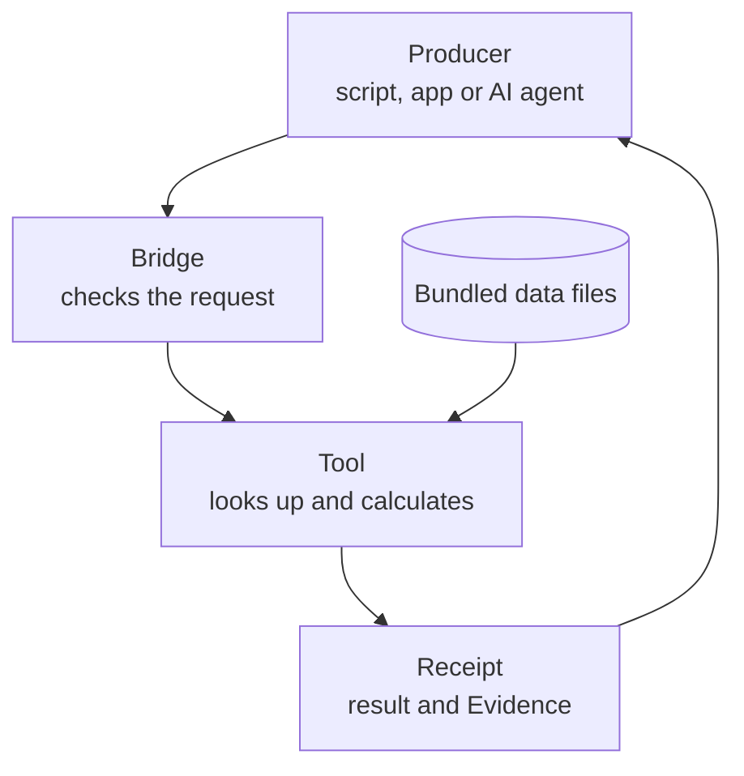

# foundation-refrigeration

A read-only checker for industrial refrigeration numbers. Ask it for a refrigerant's saturation point, a pressure or temperature conversion, ammonia exposure limits or a standard equipment name, and it answers with the source of every value. It is a *Foundation*: a checker kept separate from the program whose work it judges (see [Where it fits](#where-it-fits)).

> [!WARNING]
> **Not for life-safety decisions.** The ammonia exposure limits in this repository are reference data copied from OSHA, NIOSH and ACGIH web pages retrieved on 2026-10-06. They may be out of date. Check the current official source before you use any value. No result is an engineering, safety or compliance determination, and nothing here controls a plant.

 

## What it does for you

Say a script, an app or an AI agent reads 30 psig and 28 degF on an ammonia line and wants to say something about it. To do that correctly it needs the saturation temperature at that pressure, the right atmosphere for a gauge reading, and a clear line between "here is the arithmetic" and "this reading is bad". Agents in particular tend to guess these numbers or blur that line.

This repository gives that program one place to ask. Each answer comes back with:

- the value, always with units;
- **Evidence**: where each number came from (for example "CoolProp 8.0.0" or "NIST SP 811") and whether a qualified person has approved it;
- a hash of the request, so a result can be tied to exactly what was asked;
- a fixed **boundary** that says the result is an observation, not a diagnosis or a safety call.

It never writes files, opens network connections or talks to equipment.

## How it works



The bridge checks each request's size, numbers and message shape. The tool checks its arguments and reads the bundled data files (saturation tables, exposure limits, taxonomy), each with its source. The receipt carries the result, Evidence, the request hash and the boundary flags.

The **bridge** is the small server process your program talks to. It speaks JSON-RPC 2.0 over standard input and output, one message per line. You start it, send `initialize`, then any number of `tools/call` requests, then close stdin. A bad request is refused with a reason; a tool never guesses (for example, it refuses a blend refrigerant until you say whether you mean the bubble or the dew point). All data ships in the repository, so the same request always gets the same answer.

It borrows MCP's method names (`initialize`, `tools/call`) but is not an MCP server, so an MCP client cannot connect to it directly. The protocol is kept small and strict on purpose, so a host can check every message exactly. From your own code, start the bridge as a child process and write JSON lines to it. To give it to an AI agent, run it through a host such as Cstack, or wrap that child process in a tool of your own. There is no pip package. Python code can also import the library's claim checker directly (see [Tools](#tools)).

The tool's full answer is called a **receipt**: the result plus its Evidence, the request hash and the boundary flags (such as `observation_only: true` and `diagnosis: false`).

## Example

Compare an ammonia reading of 30 psig and 28 degF with saturation. Run this from the repository root:

```sh
printf '%s\n' \
  '{"jsonrpc":"2.0","id":1,"method":"initialize","params":{"protocolVersion":"foundation-refrigeration-jsonrpc/1"}}' \
  '{"jsonrpc":"2.0","id":2,"method":"tools/call","params":{"name":"check_reading_against_saturation","arguments":{"fluid":"ammonia","pressure":{"value":30,"unit":"psig"},"temperature":{"value":28,"unit":"degF"}}}}' \
  | python3 -B -m foundation_refrigeration_bridge \
  | tail -n 1 | python3 -c '
import json, sys
receipt = json.load(sys.stdin)["result"]["structuredContent"]["receipt"]
result = receipt["result"]
print("status:     ", receipt["status"])
print("saturation: ", result["saturation_at_reading_pressure"]["dew_temperature"])
print("superheat:  ", result["superheat_style_delta"]["value_k"], "K =", result["superheat_style_delta"]["value_degf_difference"], "degF")
print("assumed atm:", result["atmosphere"]["assumed"])
print("evidence:   ", [(e["applies_to"], e["evidence"]["status"]) for e in receipt["evidence"]][:2])
print("not judged: ", result["not_determined"][:2])
'
```

The bridge writes one reply line per request. `tail -n 1` keeps the tool's reply and drops the reply to `initialize`; the short Python script then prints a few fields from the receipt. To see the raw replies, stop the pipeline after the bridge command. (`-B` only stops Python writing `.pyc` files into the checkout.)

Output:

```text
status:      success
saturation:  {'unit': 'degC', 'value': -8.5502}
superheat:   6.328 K = 11.3904 degF
assumed atm: True
evidence:    [('saturation table NH3', 'CHECK'), ('units: temperature_scales', 'CHECK')]
not judged:  ['normal operating range', 'fault or cause']
```

What this tells you:

- At 30 psig, ammonia saturates at -8.55 degC (16.6 degF), so the reading is 11.39 degF above saturation. That is a superheat-style delta: reading temperature minus saturation temperature. Temperatures come back in degC and pressures in kPa; the delta is given both in kelvin and in degF.
- For a pure fluid like ammonia, the bubble and dew temperatures are the same. They differ for blends such as R404A, and the tool then asks which one you mean.
- No site atmosphere was given, so the tool converted gauge pressure with the standard atmosphere (101.325 kPa) and says so (`assumed: True`). You can pass a site elevation or a measured atmosphere instead.
- Each value names its source. `CHECK` means "still to be checked": the source is recorded, but no qualified person has approved it. A value becomes `APPROVED` only when a named, qualified person (for example a licensed refrigeration engineer) signs it off with a date in the data file; nothing here is approved yet. `DISPUTED` marks sources that disagree.
- The tool states what it did not decide: whether 11 degF is normal, and what caused it.

The full receipt is longer: it also carries the data file hashes, the request hash and the boundary flags. The [tutorial](docs/guides/tutorials/first-bridge-session.md) walks through a complete session, including a refused request.

## Where it fits

This is one of several **Foundations**: small, read-only checker programs, one per subject area. The program that produced the work (a person's tool, a script, or an AI agent) sends a Foundation its result or question, and the Foundation answers with an observation and the evidence behind it. A Foundation checks and reports but never acts, and it is kept separate from the producer so that nothing marks its own work. [Cstack](https://github.com/Akilleez-QA/cstack) is a host that runs Foundations for AI agents and checks each one's file hashes before starting it, but you don't need Cstack: any program that can start a process and write a line of JSON can use this one.

## Try it

You need Python 3.11 or newer (CI tests 3.12; the suite also passes on 3.11). Nothing is installed; the code runs from the checkout and uses only the standard library.

```sh
git clone https://github.com/Akilleez-QA/foundation-refrigeration
cd foundation-refrigeration
python3 -B -m unittest discover -s tests -t .
```

The last line is `OK`. Then paste the example above.

## Tools

| Tool | What it answers |
|---|---|
| `saturation_pressure` | Saturation pressure of a refrigerant at a temperature |
| `saturation_temperature` | Saturation temperature at a pressure (absolute, or gauge with a stated atmosphere) |
| `convert_pressure` | A pressure in kPa(a), kPa(g), psia, psig, bar(a) or bar(g) |
| `convert_temperature` | A temperature in degC, degF, K or degR |
| `check_reading_against_saturation` | How far one pressure/temperature reading sits above or below saturation. Arithmetic only, never a diagnosis |
| `exposure_limits` | Cited ammonia exposure limits from OSHA, NIOSH and ACGIH. Your own alarm set points are returned separately and marked as not a legal limit |
| `resolve_equipment_kind` | The standard name for an old equipment term or line-service code. Unknown terms are reported, never guessed |

Refrigerants: ammonia (R717), CO2 (R744), R134a, R290 (propane), R22, R404A, R410A, R507A and R448A. Every argument and limit is in the [tool catalog](docs/guides/reference/tool-catalog.md).

Python code can also call `foundation_refrigeration.invariants.evaluate` directly to check a pressure, temperature or saturation claim without the bridge; see the [Python interface](docs/icd/icd-cstack.md#9-python-invariant-interface).

## Limitations

- **Not for life-safety decisions.** Exposure limits cover ammonia only and come from web pages retrieved on 2026-10-06. ERPG values are not included.
- Saturation data is CoolProp 8.0.0 output over fixed ranges below the critical point. The tools refuse to extrapolate. Use REFPROP or manufacturer data for design work.
- No tool diagnoses a reading, sets an alarm level, picks protective equipment or decides whether a regulation applies.
- No value has been approved by a qualified person yet. Equipment names and line-service codes have not been reviewed by a subject-matter expert.

Read [Limitations and safety-relevant use](docs/guides/explanation/limitations.md) before relying on any number.

## Learn more

- [Tutorial: your first bridge session](docs/guides/tutorials/first-bridge-session.md)
- [How-to guides](docs/guides/how-to/README.md): run the tests, rebuild the manifest, check links
- [Tool catalog](docs/guides/reference/tool-catalog.md): every argument, unit and limit
- [Interface](docs/icd/icd-cstack.md): the bridge protocol, errors and size limits
- [Documentation index](docs/README.md)

## What is inside

| Path | Contents |
|---|---|
| `foundation_refrigeration/` | The calculations, unit conversion, Evidence records and bundled data files |
| `foundation_refrigeration_bridge/` | The stdio JSON-RPC bridge and tool schemas |
| `golden/` | Independent reference points the tests compare against |
| `tests/` | Unit, bridge and documentation tests |
| `tools/` | Source-manifest, golden-point, trace-check and documentation generators |
| `SOURCE-MANIFEST.json` | SHA-256 of every shipped file, so a host can check nothing changed |

## Related projects

- [Cstack](https://github.com/Akilleez-QA/cstack): a host that runs Foundations for AI agents.
- Sibling Foundations: [foundation-robotics](https://github.com/Akilleez-QA/foundation-robotics) (motion physics) and [foundation-film](https://github.com/Akilleez-QA/foundation-film) (film production).
- [foundation-template](https://github.com/Akilleez-QA/foundation-template): the starting point for a Foundation in a new subject.

## Engineering records

Version 0.1.0, not yet tagged. CI runs the tests on Python 3.12 in normal and optimized (`-O`) mode, checks the source manifest and scans for leaked secrets; the latest [test report](docs/verification/reports/STR-unreleased.md) has per-test results.

The project also keeps formal engineering records, organized after NASA software documentation guidance. Most readers never need them. The classification, requirements, design, interface, data dictionary, test plan, verification matrix, configuration management and assurance records are listed under [Engineering records](docs/README.md#engineering-records) in the documentation index.

Contributing: [CONTRIBUTING.md](CONTRIBUTING.md). Security reports: [SECURITY.md](SECURITY.md). Help: [SUPPORT.md](SUPPORT.md).

## License

Copyright 2026 Refrigeration.AI. Licensed under the GNU General Public License v3.0 only (GPL-3.0-only). If you want to use it to create a product or service under different terms, commercial licenses are available from Refrigeration.AI. Contact craig@nh3.biz.
