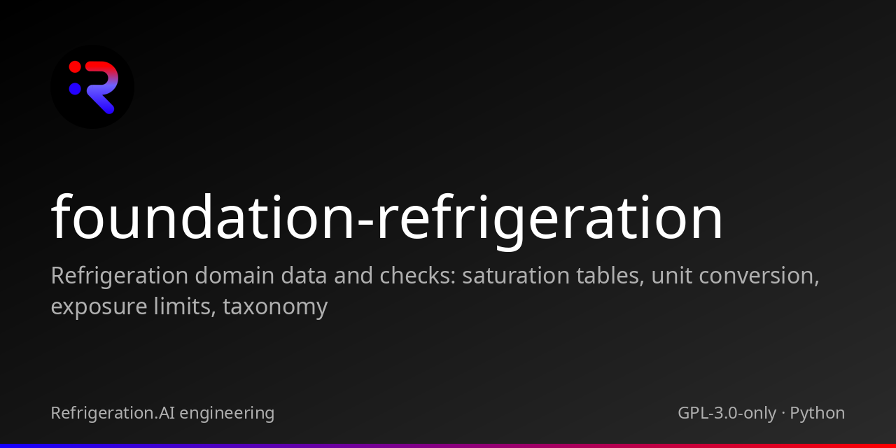

<p align="center"></p>

# foundation-refrigeration

Refrigeration domain data and checks: saturation tables, unit conversion, exposure limits, taxonomy

 

## Family

| Repository | Role | Relation |
|---|---|---|
| [cstack](https://github.com/Akilleez-QA/cstack) | Runs Foundations behind pinned adapters under one human approver | Host |
| [foundation-engine](https://github.com/Akilleez-QA/foundation-engine) | TypeScript and three.js framework for browser games | Foundation |
| [foundation-math](https://github.com/Akilleez-QA/foundation-math) | Exact mathematical kernels and physics research tools | Foundation |
| [foundation-film](https://github.com/Akilleez-QA/foundation-film) | Film-production acceptance checks | Foundation |
| [foundation-refrigeration](https://github.com/Akilleez-QA/foundation-refrigeration) | Refrigeration data and checks | Foundation |
| [foundation-robotics](https://github.com/Akilleez-QA/foundation-robotics) | Physics checks for motion | Foundation |
| [foundation-template](https://github.com/Akilleez-QA/foundation-template) | Minimal Foundation to copy for a new domain | Foundation |
| [endoforge](https://github.com/Akilleez-QA/endoforge) | Workshop for running coding agents with checks and receipts | Tool |
| [poodo](https://github.com/Akilleez-QA/poodo) | Reasoning skill that shows evidence before it acts | Tool |

## Status

Version 0.1.0, unreleased (no tags yet). Seven read-only tools behind a stdio JSON-RPC bridge, standard library only. Every successful result carries Evidence and an input hash; every value's Evidence is status CHECK (not approved by a qualified person). A result is an observation, not an acceptance decision.

Classification: self-assessed Class E analog (research and general-purpose software), not safety-critical. Class E holds only because no real engineering decision depends on this software. This is not a NASA compliance determination; see the [software management plan](docs/plan/software-management-plan.md#1-software-classification-self-assessed).

## Quickstart

```sh
git clone https://github.com/Akilleez-QA/foundation-refrigeration
cd foundation-refrigeration
python -B -m unittest discover -s tests -t .
python -B tools/build_manifest.py
```

Requires Python 3.11 or newer; nothing is installed. The tests end with `OK`, and `build_manifest.py` prints the file count and manifest SHA-256 without changing a clean checkout. To talk to the bridge, follow the [first-session tutorial](docs/guides/tutorials/first-bridge-session.md).

## What is inside

| Tool | Purpose |
|---|---|
| `saturation_pressure` | Saturation pressure at a temperature from the CoolProp 8.0.0-generated table (refrigerant-saturation/1) |
| `saturation_temperature` | Saturation temperature at a pressure (absolute or gauge with a stated atmosphere) from the generated table |
| `convert_pressure` | Convert a pressure between kPa(a), kPa(g), psia, psig, bar(a) and bar(g) |
| `convert_temperature` | Convert an absolute temperature between degC, degF, K and degR |
| `check_reading_against_saturation` | Compare one pressure/temperature reading with saturation at that pressure: superheat-style and subcooling-style deltas as an observation, never a diagnosis or a normal/abnormal call |
| `exposure_limits` | Cited ammonia exposure limits (OSHA, NIOSH, ACGIH) as reference data, with caller-supplied policy set points kept as a separate kind that is never a legal limit |
| `resolve_equipment_kind` | Resolve a legacy equipment-kind term (or a line-service code) to the canonical plant-taxonomy/1 entry |

## Measured

The generated [test report](docs/verification/reports/STR-unreleased.md) records the latest local run of the CI commands for main: the commit, the Python version, per-test results in normal and optimized mode, the trace check and the secret scan. At commit `6593910` on Linux x86_64 with CPython 3.12.14, `python -B -m unittest discover -s tests -t .` and the same with `-O` each ran 57 tests and passed.

CI runs both modes on Python 3.12, scans history with gitleaks and verifies the source manifest.

## Refrigeration invariants

`from foundation_refrigeration.invariants import evaluate` provides local Python checks for
`pressure_relation`, `temperature_relation` and `saturation_temperature`. Each accepts an explicit
claim and returns `passed`, `reason` and a source-bound `library_version`. Gauge claims require
an explicit atmosphere; saturation claims use the published tables and their error allowances.
These are read-only observations. See the [Python interface](docs/icd/icd-cstack.md#9-python-invariant-interface)
for claim fields. Received from Endoforge's `tools/invariants/refrigeration.py`; no Endoforge installation is required.

## Limitations

- **Not for life-safety decisions.** Exposure limits are cited reference data (OSHA, NIOSH and ACGIH web pages retrieved 2026-10-06, ammonia only). Check the current official source before any use. ERPG values are not included.
- Saturation tables are CoolProp 8.0.0 output over bounded, subcritical ranges, with no extrapolation. Use REFPROP or manufacturer data for design work.
- No tool diagnoses a reading, sets an alarm level, selects protective equipment or determines regulatory compliance.
- Taxonomy and line-service codes have not been reviewed by a subject-matter expert.

Details, sources and editions: [Limitations and safety-relevant use](docs/guides/explanation/limitations.md).

## Documentation

Start at [docs/README.md](docs/README.md): a [tutorial](docs/guides/tutorials/first-bridge-session.md), how-to guides, the generated [tool catalog](docs/guides/reference/tool-catalog.md), and the control documents (plan, requirements, design, interface, data dictionary, test plan, verification matrix, configuration management, assurance record).

## Layout

| Path | Contents |
|---|---|
| `foundation_refrigeration/` | Domain package |
| `foundation_refrigeration_bridge/` | stdio JSON-RPC bridge and schemas |
| `tests/` | Unit and bridge tests |
| `tools/` | Manifest, golden-point, trace-check and documentation generators |
| `docs/` | Plan, requirements, design, interface, data dictionary, verification, configuration, releases, assurance, guides |
| `SOURCE-MANIFEST.json` | SHA-256 of every shipped source file outside the root `.github/` tree |
| `golden/` | Independent reference points used by the tests |

## Contributing

See [CONTRIBUTING.md](CONTRIBUTING.md).

## Security

See [SECURITY.md](SECURITY.md).

## License

This project is available under the GNU General Public License v3.0 only (GPL-3.0-only). If you want to use it to create a product or service under different terms, commercial licenses are available from Refrigeration.AI. Contact craig@nh3.biz.
