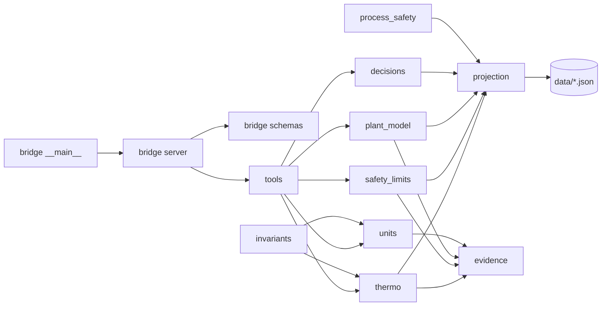
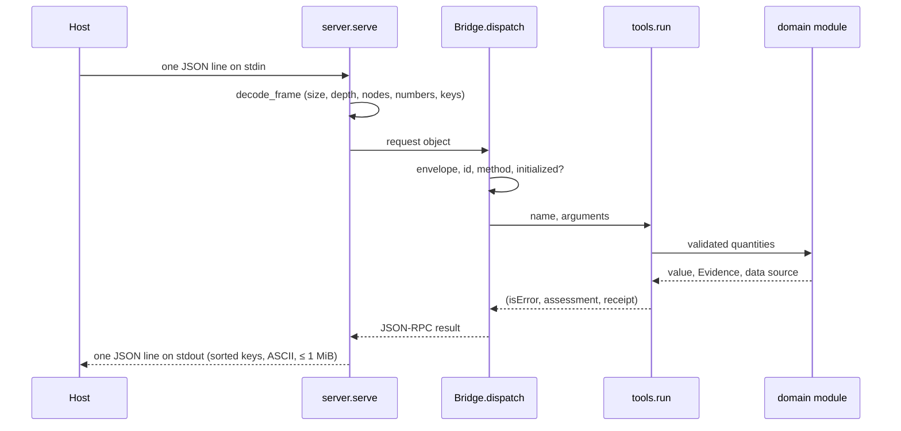

# foundation-refrigeration software design description

| Field | Value |
|---|---|
| Document ID | FREFRIG-SDD |
| Version | 2.1 |
| Status | Baselined |
| Owner | Akilleez-QA |
| Date | 2026-11-09 |
| Baseline commit | 62764c7526ce2bbf064ccf633d5295f4390fc984 |
| Applies to | foundation-refrigeration main at baseline commit |
| Classification | Self-assessed Class E analog; not safety-critical (see SMP §1) |

> Organized after [NPR 7150.2D](https://nodis3.gsfc.nasa.gov/displayAll.cfm?Internal_ID=N_PR_7150_002D_&page_name=all), [NASA-STD-8739.8B](https://standards.nasa.gov/standard/nasa/nasa-std-87398) and the [NASA Software Engineering Handbook](https://swehb.nasa.gov/display/SWEHBVD/7.18+-+Documentation+Guidance) documentation guidance. This is not a NASA compliance determination or certification. The software classification is a self-assessed analog (Class E, not safety-critical); no NASA authority, independent verification and validation, or hazard analysis is asserted. The document describes the implementation inspected at the baseline commit.

## 1. Purpose and design boundary

This document explains how foundation-refrigeration meets its [requirements](../requirements/requirements.md). It is written for someone about to change the code.

A Foundation owns the meaning, data and acceptance checks of one domain. POODO governs how it is used. The host (Cstack, through its stdio adapter) starts the bridge, pins its source and validates every result. Everything inside this repository is read-only with respect to the outside world: it reads its own data files, reads JSON-RPC requests on stdin and writes responses on stdout. It never writes files, opens network connections or controls equipment.

## 2. Design decisions and trade-offs

| Decision | Alternatives considered | Rationale | Requirements |
|---|---|---|---|
| Read-only observations; every receipt carries a fixed `boundary` object | Returning pass/fail or normal/abnormal verdicts | A Foundation reports what the data says; acceptance belongs to a person or the host | REQ-REF-009, REQ-REF-005 |
| Python standard library only | NumPy or CoolProp at runtime | The whole source can be hashed and pinned; no install step; no supply-chain exposure at runtime | REQ-REF-012 |
| Pre-generated saturation tables with ln(P)–1/T interpolation | Calling CoolProp at runtime | Bounded, reproducible output with a stated error per table; CoolProp is used only offline to make the tables and golden points | REQ-REF-019, REQ-REF-020, REQ-REF-021 |
| Refuse extrapolation and unguessed blend sides | Clamp to the table edge, or default to bubble | A wrong number presented as valid is the worst failure (S1 in SMP §9) | REQ-REF-019 |
| Numeric data only in JSON projections with an envelope (`schema`, `version`, `owner`, `generatedBy`, `data`) | Python constants | Data is reviewed and hashed as data, with provenance next to the values | REQ-REF-022, REQ-REF-021 |
| Evidence record on every value, status CHECK unless explicitly approved | Trusting values silently | Silence is not approval | REQ-REF-025, REQ-REF-010 |
| Published limits and policy set points as different types | One list of thresholds | A plant alarm level must never read as a legal limit | REQ-REF-026, REQ-REF-027 |
| Own line-delimited JSON-RPC bridge, explicitly not MCP | MCP server | A small, bounded protocol the host can verify byte for byte | REQ-REF-013, REQ-REF-017 |
| Local invariant API separate from the bridge | Exposing invariants as bridge tools | Received from Endoforge as a Python API; keeps bridge schemas and receipts unchanged | REQ-REF-014, REQ-REF-015, REQ-REF-016 |
| Process-safety screens as a library only | An eighth bridge tool | Regulatory screens need inputs the bridge contract does not carry; kept out of the pinned inventory | REQ-REF-032, REQ-REF-033 |

## 3. Architecture overview

Static view (imports):

Runtime view (one `tools/call`):

## 4. Components

| Component | Path | Responsibility | Inputs → outputs | Requirements |
|---|---|---|---|---|
| Bridge entry point | `foundation_refrigeration_bridge/__main__.py` | Disables bytecode writing and starts `server.main` | argv → exit status | REQ-REF-012, REQ-REF-035 |
| Bridge server | `foundation_refrigeration_bridge/server.py` | Frame decoding and limits, JSON-RPC envelope, handshake, dispatch, response encoding, exit status | stdin lines → stdout lines | REQ-REF-012, REQ-REF-013, REQ-REF-017, REQ-REF-035 |
| Schemas | `foundation_refrigeration_bridge/schemas.py` | Tool inventory: names, descriptions, closed input and output JSON Schemas, allowed assessments | none → tool definitions | REQ-REF-009, REQ-REF-018 |
| Tool dispatcher | `foundation_refrigeration/tools.py` | Argument checks, calls into domain modules, builds receipts (`input_sha256`, `boundary`, Evidence, data sources, limitations), maps exceptions to tool errors | tool name and arguments → (isError, assessment, receipt) | REQ-REF-001, REQ-REF-002, REQ-REF-003, REQ-REF-004, REQ-REF-005, REQ-REF-006, REQ-REF-007, REQ-REF-009, REQ-REF-010, REQ-REF-011, REQ-REF-027, REQ-REF-031, REQ-REF-034 |
| Saturation tables | `foundation_refrigeration/thermo.py` | Loads and validates nine tables at import, resolves fluid names, interpolates and refuses out-of-range or sideless lookups | fluid, temperature or pressure, side → value and side | REQ-REF-001, REQ-REF-002, REQ-REF-019, REQ-REF-020, REQ-REF-021, REQ-REF-036 |
| Units | `foundation_refrigeration/units.py` | Quantity validation, unit constants, pressure and temperature conversion, site atmosphere, unit Evidence | quantities and atmosphere → canonical values | REQ-REF-003, REQ-REF-004, REQ-REF-023, REQ-REF-024 |
| Evidence | `foundation_refrigeration/evidence.py` | Evidence and basis types, validation, legacy-vocabulary mapping | dicts → Evidence objects and back | REQ-REF-025 |
| Projection loader | `foundation_refrigeration/projection.py` | Reads a fixed-name JSON file from `data/`, refuses duplicate keys, non-finite numbers and envelope mismatch, returns data and SHA-256 | file name, schema → data, digest | REQ-REF-012, REQ-REF-021 |
| Exposure limits | `foundation_refrigeration/safety_limits.py` | Published ammonia limits, recorded gaps, policy set-point validation, mislabel detector | projection, caller policy → typed records | REQ-REF-006, REQ-REF-026, REQ-REF-027, REQ-REF-028 |
| Plant taxonomy | `foundation_refrigeration/plant_model.py` | Canonical kinds, aliases, line-service codes, lineage, legacy-list membership | term → resolution record | REQ-REF-007, REQ-REF-029 |
| Open decisions | `foundation_refrigeration/decisions.py` | Loads open expert decisions and refuses any that is chosen or not disputed | projection → decision records | REQ-REF-030 |
| Process-safety screens | `foundation_refrigeration/process_safety.py` | Federal anhydrous-ammonia quantity screen and standard-selection guard (library only) | inventory or selection record → screen record | REQ-REF-032, REQ-REF-033 |
| Invariant evaluator | `foundation_refrigeration/invariants.py` | Local Python claim checks for pressure, temperature and saturation; hashes package Python and data at import | check name, claim → result with `library_version` | REQ-REF-014, REQ-REF-015, REQ-REF-016 |
| Embedded data | `foundation_refrigeration/data/` | Thirteen JSON projections (nine saturation tables, exposure limits, PSM thresholds, taxonomy, open decisions) | none → data | REQ-REF-021, REQ-REF-022, REQ-REF-026 |
| Golden reference | `golden/` | Independent CoolProp points and generator off-grid points used only by tests | none → reference points | REQ-REF-020 |
| Manifest tool | `tools/build_manifest.py` | Writes `SOURCE-MANIFEST.json` and prints file count and manifest SHA-256 | source tree → manifest | REQ-REF-008 |
| Package version | `foundation_refrigeration/__init__.py` | Holds `__version__` | none → version string | Infrastructure |
| Golden generator | `tools/compute_golden.py` | Regenerates `golden/coolprop-8.0.0-points.json` offline; needs CoolProp 8.0.0 and `--date` | CoolProp → golden JSON | Infrastructure |
| Documentation tools | `tools/check_trace.py`, `tools/gen_docs.py`, `tools/gen_reports.py` | Trace and link check; generated tool catalog and data provenance; generated test report and version description, whose verdict fails on any failed gate, skip or unrecorded test | docs, tests, schemas, data → checks and generated Markdown | REQ-REF-037 |

## 5. Execution concept

- One process, one thread. `serve` reads one line at a time (at most 65 538 bytes per read), handles it and flushes the response before reading the next. There is no concurrency, batching or cancellation. Closing stdin ends the session with exit 0.
- State: the only mutable state is `Bridge.initialized`. Each `tools/call` is independent; tool functions are pure over their arguments and the data loaded at import.
- Import time: `thermo`, `safety_limits`, `plant_model` and `decisions` load and validate their projections when first imported. A bad data file stops the import, so the bridge cannot start with invalid data. `invariants` hashes every `foundation_refrigeration/*.py` and `data/*.json` at import; the bridge does not import it.
- Ordering: `initialize` must succeed once before `tools/list` or `tools/call`. `ping` works at any time. A request without `id` is a notification and gets no response.
- Timeouts: none inside the bridge. The host sets its own.

## 6. Interfaces

- External: the stdio JSON-RPC bridge and the local Python invariant API, both in the [Cstack ICD](../icd/icd-cstack.md). The generated [tool catalog](../guides/reference/tool-catalog.md) lists every argument.
- Data: the JSON projections and golden files, defined in the [data dictionary](../data/data-dictionary.md).
- Internal: `tools.run(name, arguments)` returns `(isError, assessment, receipt)` to the server. Domain modules raise `ToolInputError`, `ThermoError`, `UnitError`, `EvidenceError`, `SafetyLimitError` or `PlantModelError`; `tools.run` maps them to tool-error codes.

## 7. Failure handling and containment

| Failure | Handling | Requirement |
|---|---|---|
| Malformed, oversized or out-of-profile frame | JSON-RPC error `-32700` or `-32002`; no tool runs | REQ-REF-013 |
| Line longer than the frame limit, or final line without newline | Error response, then the session closes with exit 2 | REQ-REF-035 |
| Bad envelope, method, order or tool name | JSON-RPC error `-32600`, `-32601`, `-32602`, `-32000` or `-32001` | REQ-REF-017 |
| Bad tool arguments, unit, fluid, side or out-of-range value | Tool error result with code; no Evidence, no data sources | REQ-REF-010 |
| Unexpected exception in dispatch | `-32603` "Internal bridge error"; no evidence result (untested: GAP-REF-002) | — |
| Response over 1 MiB or unencodable | Withheld and replaced by `-32002` or `-32603` (untested: GAP-REF-001, GAP-REF-002) | — |
| Invalid data file | Import fails; the bridge does not start (untested: GAP-REF-006) | — |

Nothing is retried. Nothing is quarantined, because nothing is written.

## 8. Resource use

- Memory: the thirteen data files total 168 630 bytes on disk (`du -cb foundation_refrigeration/data/*.json` at the baseline commit) and are held in memory after import.
- Input is bounded per frame (64 KiB, 4096 nodes); output is bounded per frame (1 MiB).
- Disk: read-only. Network: none. Child processes: none.
- No timing has been measured or is claimed.

## 9. Quality attributes

| Attribute | How the design supports it |
|---|---|
| Correctness | Golden comparisons against an independent CoolProp run; strict monotonicity checks; exact unit constants |
| Traceability | Evidence on every value; `input_sha256`; data-source digests in every receipt; `library_version` for invariants |
| Security | Bounded parser; no paths, options, network or writes; closed schemas (see [ICD §6](../icd/icd-cstack.md#6-security-and-input-bounds) and [SECURITY.md](../../SECURITY.md)) |
| Maintainability | Small modules with one concern each; data in JSON; generated reference documentation |
| Testability | Pure functions; the bridge can be driven in-process (`Bridge.dispatch`) or as a real child process |
| Portability | Standard library only; Python 3.11+; tested in CI on Python 3.12 on Ubuntu |
| Usability | Errors name the field and the allowed values; results include unit views and explicit assumptions |

## 10. Assumptions and limitations

- The host validates each response against the pinned output schema. The bridge does not validate its own output against `outputSchema` at runtime.
- The saturation tables cover bounded ranges (see [reference data](../data/reference-data.md)); there is no critical-point or supercritical data.
- CoolProp mixture models use default mixing parameters; the tables say REFPROP should be used for design work.
- Taxonomy and line-service codes have not been reviewed by a subject-matter expert (status CHECK).
- See [Limitations and safety-relevant use](../guides/explanation/limitations.md).

## Change history

| Version | Date | Commit | Change | Reviewed in |
|---|---|---|---|---|
| 1.0 | 2026-10-30 | 9b459ef | Context, components, tools, data flow, decisions | Initial commit |
| 1.1 | 2026-11-01 | 4bd3311 | Invariant evaluator component | PR #3 |
| 2.0 | 2026-11-08 | 62764c7 | NASA-standard structure; all modules listed with requirement IDs; process-safety module documented; execution, failure and quality sections | PR adding the NASA-standard documentation set |
| 2.1 | 2026-11-09 | e58a71c | Documentation tools allocated REQ-REF-037 | PR fixing the 2026-11-09 backfill-review findings |
